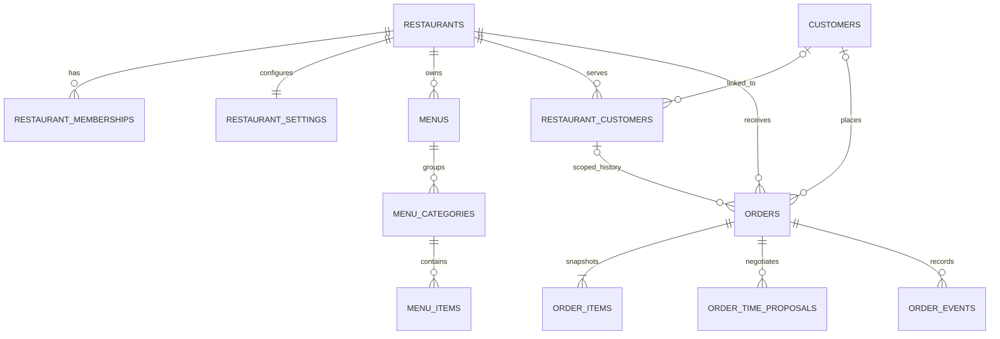

# OrderPilot Platform: модель данных и план подключения

**Статус:** проектное предложение для обсуждения. Это не SQL и не миграция. Файл не подключается к Supabase и не меняет данные.

## Цель

Перейти от текущей модели «одна копия сайта и одна база на ресторан» к общей платформе, где каждому ресторану принадлежат его настройки, меню, сотрудники и заказы. Один клиентский аккаунт сможет видеть историю своих заказов в разных ресторанах, а гостевые заказы будут доступны ресторану только в рамках конкретного заказа и ресторана.

Текущие таблицы `orders` и `order_items` содержат данные одного сайта: ресторан в заказе не указан. Черновики CRM добавляют клиентские связи в эту модель, но не создают реестр ресторанов, членство сотрудников или изоляцию нескольких ресторанов. Поэтому перенос черновиков CRM в качестве готовой платформенной схемы не подходит.

## Предлагаемые сущности

| Сущность | Ключевые данные | Назначение |
|---|---|---|
| `restaurants` | UUID, публичный slug, имя, статус, страна, часовой пояс, валюта | Tenant и адрес ресторана в платформе. Slug уникален для QR-ссылки. |
| `restaurant_memberships` | `restaurant_id`, `auth.users.id`, роль, статус | Связь сотрудника с рестораном: владелец, менеджер или сотрудник. Один аккаунт может работать в нескольких ресторанах. |
| `restaurant_settings` | режимы доставки/самовывоза, сбор, минимальный заказ, время подготовки, часы работы, зона доставки | Настройки, принадлежащие ровно одному ресторану. Проверка цены и доступности выполняется сервером. |
| `menus` | `restaurant_id`, название, активность, расписание | Одно или несколько меню ресторана. |
| `menu_categories` | `restaurant_id`, `menu_id`, название, порядок, видимость | Категории конкретного меню с tenant-ограниченными ссылками. |
| `menu_items` | `restaurant_id`, `category_id`, имя, описание, цена в центах, доступность, порядок | Товары ресторана. Цена для заказа копируется в позиции заказа как снимок. |
| `customers` | UUID, необязательная связь с `auth.users`, профиль | Клиентская учётная запись, если клиент зарегистрировался. Телефон сам по себе не объединяет аккаунты. |
| `restaurant_customers` | `restaurant_id`, необязательный `customer_id`, имя/контакты ресторана, даты первого и последнего заказа | Локальная история отношений между клиентом и рестораном. Гостевой профиль остаётся ресторанным; одинаковый номер в двух ресторанах не сливает людей. |
| `orders` | `restaurant_id`, необязательные `customer_id` и `restaurant_customer_id`, уникальный номер внутри ресторана, тип получения, контактный и адресный снимок, суммы в центах, статус, запрос клиента | Заказ всегда принадлежит одному ресторану. Связь с клиентским аккаунтом необязательна для гостевого checkout. |
| `order_items` | `restaurant_id`, `order_id`, название товара-снимок, количество, цена за единицу в центах, сумма строки | Состав и цены на момент заказа; последующее изменение меню не меняет старый заказ. |
| `order_time_proposals` | `restaurant_id`, `order_id`, номер раунда, предложенное время, длительность, автор, ответ клиента, временные метки | История каждого предложения времени и решения клиента. Новое предложение создаёт новый раунд, прежний не перезаписывается. |
| `order_events` | `restaurant_id`, `order_id`, тип события, автор, безопасное сообщение, время | Неизменяемая история переходов статуса и действий сторон. |
| `notification_outbox` | `restaurant_id`, `order_id`, адресат, канал, шаблон/ссылка на событие, статус доставки | Будущая очередь уведомлений. Добавляется только после выбора канала, проверки требований и отдельной реализации провайдера. |

Денежные суммы следует хранить в целых единицах валюты (например, евроцентах), а не принимать расчёт браузера. В каждой tenant-зависимой таблице нужен `restaurant_id`; внешние ключи и уникальные ограничения должны связывать дочернюю запись с тем же рестораном.

## Статусы и согласование времени

Предлагаемая последовательность для нового заказа:

1. `pending_restaurant` — заказ получен, ресторан ещё не ответил.
2. Ресторан создаёт `order_time_proposals` с временем готовности или доставки; заказ переходит в `awaiting_customer_time`.
3. Клиент отвечает на конкретное предложение: `accepted` или `change_requested`.
4. При `change_requested` ресторан создаёт следующий раунд. Предыдущие раунды остаются в истории.
5. После принятия времени заказ проходит рабочие статусы `preparing`, `ready`/`out_for_delivery`, `completed` либо завершается `cancelled` по согласованному правилу.

Нужны отдельные ограничения на допустимые переходы, повторную отправку ответа, истечение предложения и отмену. Клиент должен отвечать на ID конкретного раунда, чтобы поздний ответ на устаревшее время не подтвердил новое предложение.

## Доступ и изоляция

- Публичный QR-маршрут использует публичный slug и показывает только опубликованное меню активного ресторана.
- Ресторанская сессия получает `restaurant_id` из проверенного членства, не из доверенного значения формы. Все запросы к заказам, настройкам и меню фильтруются этим tenant.
- Row Level Security применяется ко всем tenant-таблицам; политика проверяет активное членство и нужную роль. Наличие `restaurant_id` в запросе не является проверкой доступа.
- Клиент с аккаунтом видит только заказы, связанные с его `auth.users.id`. Телефонный поиск не должен открывать чужую историю.
- Для гостевого отслеживания использовать случайный токен высокой энтропии; в базе хранить только его хэш. Публичный номер заказа не является секретом или способом авторизации.
- `SUPABASE_SECRET_KEY` используется только сервером. Публичный checkout не принимает авторитетные цены, сборы, итоговые суммы, статус или `customer_id` от браузера.
- Изменения заказа и предложения времени фиксируются в append-only журнале событий; права сервиса обходят RLS только в конкретных серверных обработчиках с проверкой авторизации.

### Матрица доступа для проектирования RLS

| Данные/действие | Гость | Клиент с аккаунтом | Сотрудник ресторана | Серверный обработчик |
|---|---|---|---|---|
| Публичная карточка и опубликованное меню | Читать опубликованное | Читать опубликованное | Читать ресторан из членства; менять по роли | Читать по slug и состоянию публикации |
| Настройки ресторана и черновики меню | Нет | Нет | Читать/менять только свой tenant по роли | Читать/менять после проверки членства или процесса onboarding |
| Создание заказа | Только через публичный API | Только через публичный API | Не от имени клиента | Проверить меню, режим получения, сумму, ограничения и идемпотентность; создать заказ и позиции одной транзакцией |
| Заказ и позиции | Только через секретный гостевой токен в API | Читать свои связанные заказы | Читать только заказы своего ресторана; менять разрешённые статусы через API | Проверить token/customer/restaurant membership на каждом запросе |
| Предложение времени | Ответить через одноразовый/непредсказуемый токен заказа | Ответить только на заказ своего аккаунта | Создать для заказа своего ресторана; прочитать историю этого заказа | Проверить актуальность предложения, сторону ответа и переход статуса |
| Профиль клиента | Нет | Читать/изменять свой аккаунт | Только локальный профиль клиента своего ресторана | Минимизировать и ограничивать серверный доступ |
| История и события | Только относящиеся к заказу по гостевому токену | История только собственных заказов | Только события и история своего ресторана | Append-only запись после успешной операции |
| Уведомления | Нет доступа к очереди | Только настройки своих каналов (будущий этап) | Нет доступа к секретам провайдера | Создать outbox событие после транзакции и отправить через провайдер (будущий этап) |

Эта матрица задаёт ожидаемое поведение, а не готовые политики. Для SQL-политик нужно отдельно определить роль каждого endpoint, функции проверки членства, сценарий гостевого токена и действия owner/manager/staff. Политики следует проверять негативными тестами: попытки прочитать или изменить данные соседнего ресторана должны быть запрещены даже при подстановке известного UUID.

### Роли сотрудников ресторана

| Роль | Меню и настройки | Заказы | Сотрудники и доступ |
|---|---|---|---|
| `owner` | Читать и менять все настройки и меню своего ресторана | Читать и обрабатывать заказы своего ресторана | Приглашать и отключать сотрудников, назначать роли; передавать владение по отдельному подтверждённому сценарию |
| `manager` | Читать и менять меню, часы и операционные настройки | Читать и обрабатывать заказы, предлагать время, менять разрешённые рабочие статусы | Просматривать список сотрудников; не менять владельца и роли владельца |
| `staff` | Читать опубликованное меню и операционные сведения, необходимые для заказа | Читать и обрабатывать заказы в пределах разрешённых операций | Нет управления участниками и доступом |

Роли действуют отдельно для каждого членства: сотрудник может быть менеджером одного ресторана и сотрудником другого. Сервер проверяет активное членство, ресторан и разрешение на конкретную операцию при каждом изменении.

### Инварианты, которые нужно обеспечить

- `restaurants.slug` уникален после нормализации регистра; заказ имеет уникальный номер в паре с рестораном.
- `restaurant_id` обязателен у всех ресторанских данных. Составные ключи/внешние ключи не позволяют связать позицию, предложение или событие с заказом другого ресторана.
- Цена, сбор и сумма неотрицательны; количество — целое положительное. Итог вычисляется сервером из актуального меню и копируется в заказ/позиции.
- `order_items` — снимок названия, цены и количества; удаление товара из меню не удаляет историю заказов.
- Номер раунда предложения времени уникален внутри заказа. В один момент для заказа может быть не более одного активного предложения; ответ нельзя применить к устаревшему или уже закрытому предложению.
- Гостевой токен заказа хранится только как криптографический хэш; токен не попадает в логи, аналитику, referrer или идентификатор, который легко перебрать.
- Заказ, позиции, стартовое событие и idempotency key сохраняются атомарно. Повтор запроса с тем же ключом не создаёт дубль.
- Журнал событий и принятые предложения не редактируются задним числом обычными ролями; отмена оформляется новым событием с автором и причиной.

## Черновые API-контракты

- `GET /api/public/restaurants/{slug}/menu` — опубликованное меню, режимы получения и публичная информация ресторана.
- `POST /api/public/restaurants/{slug}/orders` — проверка доступности, цен, количества, адреса и идемпотентного ключа; сервер сам рассчитывает сумму и создаёт гостевой или аккаунтный заказ.
- `GET /api/customer/orders/{id}` — история только для вошедшего клиента; альтернативный endpoint для гостя проверяет секретный токен заказа.
- `GET /api/restaurant/orders` — новые и активные заказы только ресторанов из членства текущего сотрудника.
- `POST /api/restaurant/orders/{id}/time-proposals` — предложение времени с серверной проверкой доступа и допустимого статуса.
- `POST /api/customer/orders/{id}/time-proposals/{proposalId}/response` — принятие или запрос другого времени; сервер проверяет, что предложение актуально и относится к заказу клиента.
- `GET /api/customer/orders` — список истории только для текущего аккаунта клиента; гостевые заказы сюда не попадают автоматически.
- `GET /api/guest/orders/{token}` — ограниченный статус и состав одного гостевого заказа; сервер проверяет хэш токена и не раскрывает другие заказы или профиль ресторана.
- `POST /api/restaurant/orders/{id}/status` — изменение только разрешённого рабочего статуса участником ресторана с подходящей ролью; каждое изменение записывается в журнал событий.
- `POST /api/restaurant/invitations` и `POST /api/restaurant/invitations/{id}/accept` — будущий поток приглашения сотрудника; приглашение привязано к ресторану и назначаемой роли, а принятие требует входа сотрудника.

Сценарий клиента: меню открывается по публичному slug/QR; checkout допускает гостя либо текущий аккаунт. Гость получает непредсказуемый секретный токен для ссылки статуса. Вошедший клиент получает заказ, связанный с его аккаунтом, и видит его в общей истории между ресторанами. Одинаковый телефон не используется для автоматического объединения гостевого заказа с аккаунтом. Привязка прежнего гостевого заказа к аккаунту возможна только через отдельное подтверждение владения.

Названия и формы контрактов предварительные; перед реализацией их нужно сверить с интерфейсом кабинета и требованиями onboarding.

## Порядок реализации

1. Зафиксировано для прототипа платформы: доступны оба варианта — гостевой checkout и оформление через аккаунт. Перед внедрением определить срок хранения контактов гостя и способ восстановления гостевого доступа.
2. Согласовать роли ресторана и правила отмены/истечения предложений и поддержки повторных раундов времени.
3. Зафиксировать ER-модель, индексы, ограничения, RLS-матрицу и API-контракты; сделать отдельную ревизию безопасности.
4. Реализовать схему только в отдельном staging Supabase проекте после отдельного разрешения на миграции. Применение к рабочей базе не входит в этот документ.
5. Добавить ресторанское приглашение, вход сотрудников, меню, настройки и серверный checkout с суммами, вычисляемыми на сервере.
6. Проверить межарендную изоляцию тестовыми аккаунтами нескольких ресторанов, клиентскую историю, QR-ссылки, конкурентные запросы и все ветки времени.
7. Спланировать перенос существующих ресторанов отдельно. Текущие CRM-отчёт и черновая схема отмечают, что старые заказы нельзя автоматически связать друг с другом по имеющимся данным; любые совпадения требуют ручной проверки. Историю одной базы нельзя копировать в другую без согласованного mapping и аудита.
8. Только после проверки изоляции выбрать и подключать уведомления. Предпочтения и юридические основания для сервисных и маркетинговых сообщений следует рассматривать раздельно.

### Подготовка тестового окружения (без подключения)

Перед первым реальным подключением подготовить отдельный staging-проект и пройти контрольный список:

1. Создать staging-проект отдельно от рабочей базы; не переиспользовать production URL, ключи, копии клиентских данных или `.env`.
2. Назначить тестовые рестораны и сотрудников с разными ролями; использовать только вымышленные контактные данные и меню.
3. Перенести утверждённую ER-модель в отдельные миграции после ревью; включить RLS до добавления прикладных экранов.
4. Проверить, что гость видит заказ только по секретному токену, аккаунтный клиент — только собственные заказы, а сотрудник — только данные ресторанов из активного членства.
5. Проверить серверный расчёт цены, повторные запросы checkout, устаревшие предложения времени, отмену и конкурентное изменение заказа.
6. Проверить резервное копирование и удаление тестовых данных; только после успешной приёмки отдельно планировать production-переход.

Это план следующих работ, а не указание выполнять подключение или создавать миграции сейчас.

## Открытые решения до схемы

**Решение для прототипа:** разрешить заказ без регистрации и через аккаунт. Гостевая история остаётся у конкретного ресторана и открывается по защищённой ссылке заказа, которую клиент сохраняет самостоятельно; история между ресторанами доступна только вошедшему клиенту. Предлагаемый срок гостевого доступа и оперативного отображения контактных данных — 48 часов после завершения или отмены заказа; пока заказ активен, доступ остаётся доступен сторонам заказа. По окончании срока удалить или обезличить контактные данные в операционном слое. Документы заказа, которые ресторан обязан хранить для бухгалтерского/налогового учёта, должны учитываться отдельно с ограниченным доступом и собственным сроком хранения. Точные правила удаления и legal hold нужно утвердить с ресторанами до запуска. Совпавший телефон не объединяет заказы автоматически.

- Какие поля входят в бухгалтерский документ и как отделить их архивирование от удаления гостевых контактов?
- Может ли клиент подтвердить связь гостевого заказа с аккаунтом позже и каким способом доказать владение заказом?
- Какие часовой пояс, валюта, налоговые и ценовые правила применяются при подключении ресторана?
- Заказ подтверждает ресторан одним действием или сначала отдельно принимает состав заказа, затем согласовывает время?
- После скольких отказов времени заказ отменяется или требует ручного контакта?
- Какие статусы доставки нужны: собственный курьер, самовывоз или внешний агрегатор?

Ответы на эти вопросы влияют на схему и должны быть согласованы до создания миграций.
